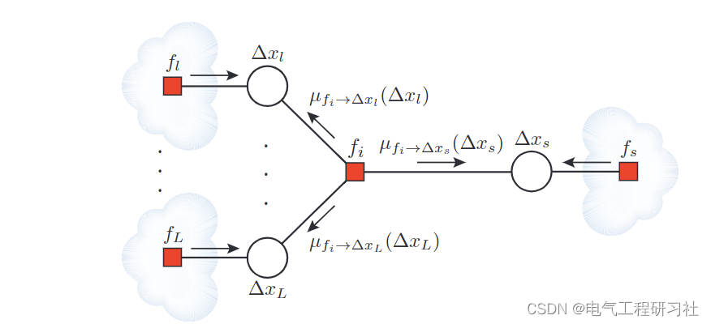
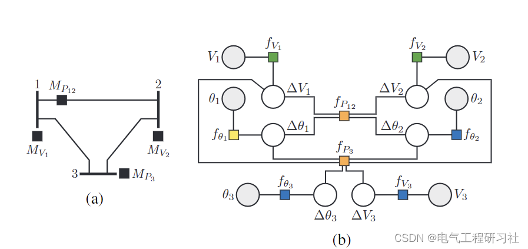
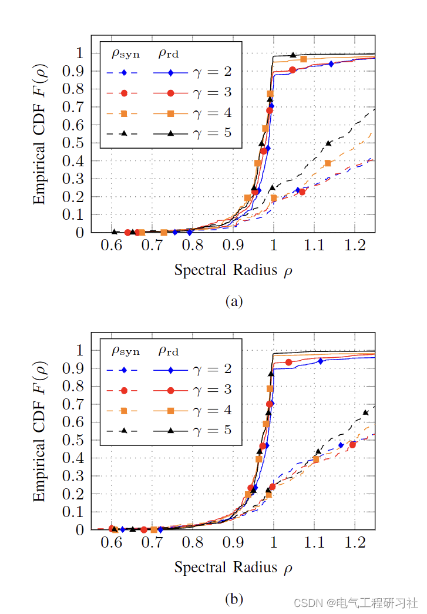
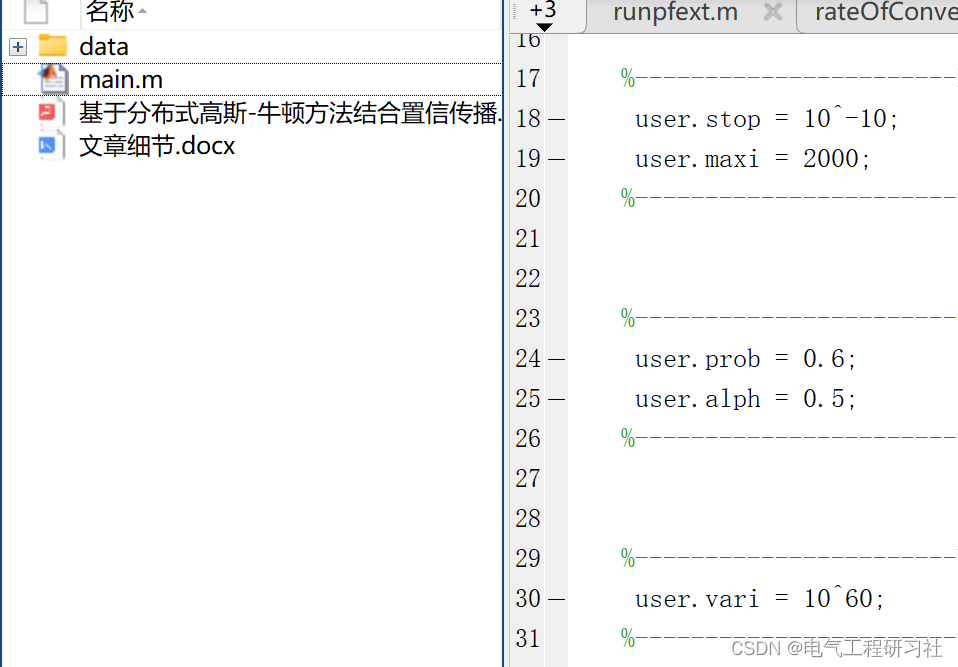

# Power System | Nonlinear State Estimation (SE) Model Based on Distributed Gaussian-Newton Method Combined with Confidence Propagation (BP) for Probabilistic Inference (Matlab Implementation)

​  
1. Overview: The power system consists of distributed generation, transmission, and consumption across extensive geographical regions. They are operated by power system operators from control centers. Maintaining normal operational conditions is crucial for power system operators [1]. Control centers traditionally operate in a centralized and independent manner. However, the increase in system scale and complexity, as well as external socio-economic factors, has led to deregulation of the power system, resulting in a decentralized structure of distributed control centers. Cooperation in control and monitoring across distributed control centers is crucial for efficient system operation. Therefore, existing centralized algorithms must be redefined according to new requirements for distributed operations, scalability, and computational efficiency.
This paper introduces a new distributed Gaussian-Newton method for nonlinear state estimation (SE) models based on the probabilistic inference method known as Belief Propagation (BP). The main novelty of our work stems from the sequential application of BP on a series of linear approximations of the SE model, similar to how Gauss-Newton methods are applied. The resulting iterative Gaussian-Newton belief propagation (GN-BP) algorithm can be interpreted as a distributed version of the Gaussian-Newton method with the same accuracy as centralized SE, but with many advantages of the BP framework. This paper provides extensive numerical studies of the GN-BP algorithm, providing detailed information about its convergence behavior.
Editor
GN-BP is the first nonlinear SE model solution based on BP, achieving the same precision as centralized SE through the Gauss-Newton method. Compared to distributed SE algorithms that utilize matrix decomposition, GN-BP is robust to pathological scenarios caused by significant differences in measurement variances, allowing for the inclusion of an arbitrary number of pseudo measurements without affecting the observable solution islands. Due to the sparsity of the underlying factor graph, the GN-BP algorithm has optimal computational complexity (linear per iteration), making it particularly suitable for solving large-scale systems. GN-BP can be easily designed to provide asynchronous operations and integrated into real-time systems, where new measurement arrivals are processed immediately upon receipt [23]. GN-BP can easily integrate new measurements: when a new measurement arrives at the control center, a new factor node will be defined as part of the time-continuous process seamlessly integrated into the graph. In multi-regional scenarios, the GN-BP algorithm can be implemented in non-overlapping multi-region SE scenarios without a central coordinator, where the GN-BP algorithm neither requires exchange of measurement values nor the local network topology between neighboring regions. The GN-BP algorithm is flexible and easy to distribute and parallelize. Therefore, even within the framework of centralized SE, it can flexibly match distributed computing resources (e.g., parallel processing on graphics processing units).

Mathematical models are detailed in Part 4.

Example simulations are edited in Part 3.

Matlab code and detailed explanations are edited in Part 4.
5 Conclusion In this paper, the author Mirsad Cosovic proposes a novel GN-BP algorithm, which is an efficient and accurate implementation of the iterative Gauss-Newton method based on BP. The GN-BP can be highly parallelized and flexible distributed in the context of multi-region SE. In our ongoing work, we are studying online bad data detection in asynchronous, dynamic, and real-time SE with GN-BP, and will receive future support from 5G communication infrastructure.
6 End Note

## Images

<!-- PAYMENT_BLOCK -->

## Get this dataset

- Payment link (Stripe): [Buy now](https://buy.stripe.com/3cs8yP7sY87d0vu9AB)
- Payment QR code: 

<!-- /PAYMENT_BLOCK -->
